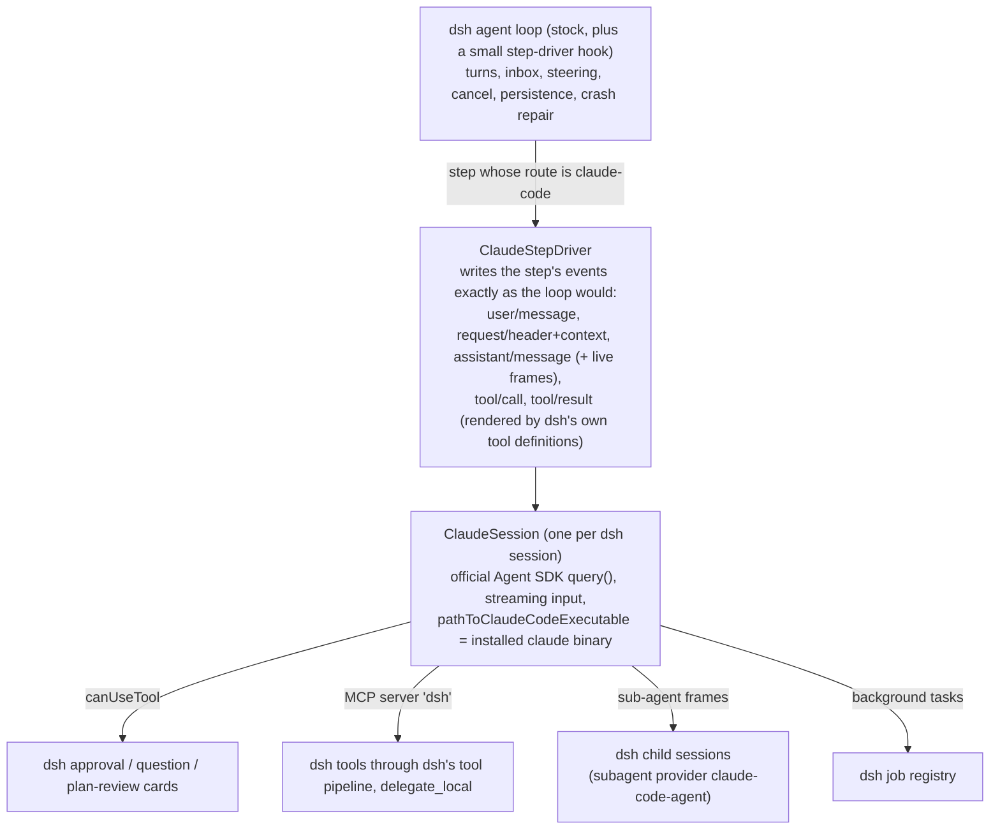

# dsh-claude-code-provider

Claude Code as a first-class agent inside DeepSeek Harness (dsh 0.2.0-rc.1), on your own Claude Code
login.
runs as the **unmodified, officially installed `claude` binary**, driven through Anthropic's official
Agent SDK.

## What you get

- **Main agent, per session.** The plugin adds a `claude-code` provider. Its models (`Claude Code -
  Default / Opus / Sonnet / Haiku ...`) sit in the normal model picker next to your DeepSeek and local
  models. Pick one, and Claude Code drives that session; every other session is untouched.
  - You can set either kind as the default model. Nothing is preset.
  - Switching a session's model mid-conversation hands the new model a transcript of what it missed,
    in both directions.
- **Claude Code subagents for dsh sessions.** `claude_agent` (a Claude worker that edits under the parent's permissions), `claude_plan` and `claude_review` are ordinary
  `dsh-tool-subagent` rows on the `spawn` provider, with a Claude Code route, a `persona` (the role)
  and a `toolFilter` (read-only).
  - They're continuable, so the parent uses `send_message` for follow-ups.
  - They show in the subagent panel like any dsh child.
- **Your local model for Claude Code.** In a Claude-driven session, Claude has `delegate_local`.
  - It runs your configured local model as a continuable dsh subagent and returns its report plus an
    agent id; passing `agent_id` continues the same agent.
  - One job at a time.

## It is the dsh UI, not a wrapper

A Claude-driven session is an ordinary dsh session. Every feature below is native dsh, fed by Claude:

| dsh feature | How it works for Claude Code |
|---|---|
| Streaming text and thinking | Claude's partial messages stream through dsh's own live frames. Thinking is shown summarized. |
| Tool cards | Each Claude tool call is recorded as the matching dsh tool (`bash`, `read`, `edit`, `write`, `grep`, `glob`, `web_fetch`, `web_search`, `todo_write`, `read_image`). Its result is rendered by that dsh tool's own `render()`/`presentationMeta()` from Claude's structured output: terminal card with exit code, read card with line numbers, diff cards, search cards, web cards, stored image attachments. |
| Approvals | Claude's permission prompts become dsh's approval card (Allow once / Reject), attached to the tool card, in the web UI. |
| Permissions selector | Follows dsh's sandbox, as dsh's own tools do. Workspace Write -> Claude `acceptEdits`, with shell commands run through dsh's own sandboxed `bash` (Claude Code's own sandbox can't run in the container). Read-only -> `default`, also with dsh bash. Full access -> `bypassPermissions` (with `allowBypass`, else `auto`), with Claude's own Bash. Auto -> `auto`. Anything Claude still asks about goes to dsh's approval card. In a subagent, dsh refuses it automatically (children run with approval policy "never"), exactly as for dsh's own subagents. |
| Plan mode (`/plan`) | Claude runs in its own `plan` mode. ExitPlanMode becomes dsh's plan review card; Approve leaves plan mode in both, Request changes returns your feedback. |
| Questions | Claude's AskUserQuestion becomes dsh's question card; your answers go back to Claude. |
| To-dos | Claude's TodoWrite and TaskCreate/TaskUpdate drive dsh's to-do dock and todo cards. |
| Subagents | Claude's own sub-agents (its Agent tool) become real dsh child sessions in the sidebar tree and subagent panel, with their full transcripts and tool cards. |
| Background jobs | Claude's background commands become dsh jobs (jobs panel, `job_output`, notices). Stopping one in dsh stops it in Claude. |
| dsh's own tools | Over an in-process MCP server, Claude gets every dsh tool it has no native equivalent for: deliverables (`present`), goals (`/goal`, `create_goal`/`update_goal`), dsh skills, schedules, dsh subagents and `send_message`, jobs, terminals, LSP, session search, and the rest. They run through dsh's own tool pipeline, so their cards, policies and notices are dsh's. |
| Stop, steer, queue | Stop interrupts Claude. Ctrl+Enter steers into Claude's running turn. Queued messages become Claude's next turn. |
| Compaction | Claude Code owns its context and auto-compacts it; dsh mirrors each Claude compaction into its own history after the turn, with Claude's summary. `/compact` on an idle Claude session runs Claude Code's own `/compact` the same way. dsh's step-pressure compaction skips Claude routes (the `dsh-compaction-basic` patch, see [dsh patches](#dsh-patches)): it can't shrink Claude's context, so on its own it would re-trigger every step. |
| Fork / branch | Branching a dsh session forks Claude's conversation at exactly that message. |
| Resume | After a dsh restart, a session continues the same Claude conversation. |
| Model and effort picker | Claude model and effort, changed live. |
| `@file`, session references, attachments | `@path` mentions are expanded by Claude Code itself. Images are sent as images, files as their saved paths. Session references arrive as context. |
| Claude's slash commands and skills | Offered as dsh commands in Claude sessions (unless dsh already has that command name). |
| Usage, context meter, trajectory | Fed from Claude's per-message usage and dsh's own request records. |

## How it works



dsh's agent loop has no extension point for "this route runs the whole step", so the plugin needs
two small patches to dsh itself. They're in `patches/`, described below.

## dsh patches

dsh treats every model in the picker as a plain model endpoint: it sends the messages and the tool
list, gets text and tool calls back, runs the tools itself and sends the next request. Claude Code is
not an endpoint. It's a whole agent with its own loop, tools, context and compaction. The only way to
make it look like an endpoint would be to take your OAuth token and call Anthropic's API directly,
which breaks Anthropic's terms. So instead dsh gets two small hooks that let a provider run whole
steps and keep its own context.

Both patches target **dsh 0.2.0-rc.1** and touch one file each. Sessions on other models run exactly
as before. Neither hook is Claude-specific: any agent-style provider could use them.

### 1. `@deepseek-ai/dsh-agent-loop`: step drivers

- **What it adds:** `agentLoop.registerStepDriver(provider, driver)` and `agentLoop.stepDrivers`.
- **Where it acts:** in `step()`, once a step's route resolves to a provider with a registered driver,
  that driver runs the step instead of the model request. It gets the agent, the turn and step, the
  abort signal, the routed config, the prepared call and the messages, and returns how the step ended
  (`completed`, `max-tokens`, or `null` to continue the turn).
- **What stays the same:** turns, the inbox, steering, cancellation, persistence and crash repair are
  still dsh's. The plugin's driver writes the step's events exactly as the loop would, so the UI,
  approvals and history all work.
- **Without it:** the plugin logs an error at startup and Claude Code sessions fail with
  `CLAUDE_CODE_LOOP_NOT_PATCHED`.

### 2. `@deepseek-ai/dsh-compaction-basic`: no pressure compaction on Claude routes

- **What it adds:** before each step, dsh's pressure compaction is skipped when the routed provider's
  step driver declares `ownsContext: true`. The plugin's driver does.
- **Why:** dsh compacts when the last request's token usage crosses its threshold. On a Claude route
  that usage is Claude's own context, and compacting dsh's copy of the history doesn't shrink it, so
  dsh would compact again at every step boundary (one real case: 15 compactions in a single turn,
  each a `/compact` or summary call).
- **What stays the same:** Claude Code compacts itself and the plugin mirrors each compaction into
  dsh. Manual `/compact` and every other route are unchanged.
- **Without it:** Claude sessions work, but long ones hit that compaction loop.

### Files and applying

```
patches/
  dsh-agent-loop-0.2.0-rc.1-index.diff          readable diff
  dsh-agent-loop-0.2.0-rc.1-index.orig.js       dsh's original lib/index.js
  dsh-agent-loop-0.2.0-rc.1-index.patched.js    the patched file
  dsh-compaction-basic-0.2.0-rc.1-index.*       the same for dsh-compaction-basic
  SHA256SUMS                                    hashes of the .js files
  LICENSE.deepseek                              dsh's MIT license (the .js files are dsh's code)
```

```sh
scripts/apply-patches.sh --check   # report original / patched for each file
scripts/apply-patches.sh           # patch
scripts/apply-patches.sh --revert  # put dsh's originals back
```

The script finds dsh from the `dsh` on your `PATH`, else the npx cache, or takes the
`@deepseek-ai/dsh` package directory as its last argument. It only replaces a file that is
byte-identical to the known original (or patched) file, checks both files before changing either,
and refuses any other dsh version. A global npm install is usually root's, so run it with `sudo`
there. Restart dsh afterwards. Reinstalling or updating dsh drops the patches; run it again.

## Install

Prerequisites:

- dsh 0.2.0-rc.1 (`npm install -g @deepseek-ai/dsh@0.2.0-rc.1`, or run it with npx).
- Claude Code, installed with Anthropic's installer (`curl -fsSL https://claude.ai/install.sh | bash`)
  and logged in by you with `claude auth login` (or see `auth: api-key` below).

Then, for a dsh profile (`web` here):

```sh
# 1. build the plugin
npm install && npm run build && npm pack

# 2. patch dsh (see "dsh patches" above)
scripts/apply-patches.sh

# 3. keep the Agent SDK's bundled Claude Code CLI out of the profile: add this to
#    ~/.dsh/profiles/web/pnpm-workspace.yaml
#      ignoredOptionalDependencies:
#        - '@anthropic-ai/claude-agent-sdk-*'

# 4. install it into the profile, then restart dsh
dsh plugin --profile web add "$PWD/dsh-claude-code-provider-0.0.1.tgz"
```

Step 3 matters: the plugin only ever starts your installed `claude` binary, and the SDK's platform
packages would otherwise put a second, bundled CLI into the profile.

## Configuration (`claude-code` row in `cordis.patch.yml`)

| Field | Default | Meaning |
|---|---|---|
| `provider` | `claude-code` | Provider route name |
| `claudePath` | `~/.local/bin/claude`, else `PATH` | The installed binary |
| `auth` | `subscription` | `subscription`: the binary uses its own `claude auth login`; `ANTHROPIC_API_KEY` / `ANTHROPIC_AUTH_TOKEN` are removed from its environment. `api-key`: the binary gets the environment unchanged and uses `ANTHROPIC_API_KEY`. |
| `permissionMode` | `follow-dsh` | Follow the session's dsh permission preset (and plan mode), or fix one Claude mode |
| `allowBypass` | `false` | Map Full access to Claude `bypassPermissions` instead of `auto` |
| `local` | none | `{ provider, model, reasoningEffort?, persona?, subagentProvider? }` for `delegate_local`. Leave it unset to turn the tool off. |
| `disallowedTools` | `[]` | Claude Code tools never offered |
| `allModels` | `false` | List every model the binary reports, not only the aliases |
| `stateDir` | `$DSH_HOME/storages/claude-code` | Fallback dsh-session -> Claude-session map. The primary record is on each assistant message. |

Claude-role rows go in the agent preset's delegation group:

```yaml
- id: tool-subagent-claude-plan
  name: '@deepseek-ai/dsh-tool-subagent'
  config:
    provider: spawn
    toolName: claude_plan
    backgroundMode: continuable
    agentOptions: { provider: claude-code, model: default }
    persona: You are a planning subagent ... (appended to Claude Code's system prompt)
    toolFilter: { deny: [edit, write, bash] }   # hides Claude's Edit/Write/Bash too
```

Don't enable dsh's own `tool-subagent-claude-code` row. That provider runs the SDK's bundled CLI,
never your installed binary.

## Terms of service

Read <https://code.claude.com/docs/en/legal-and-compliance> ("Authentication and credential use")
yourself. As of 2026-10-16:

- Anthropic says developers building products on the Agent SDK should use API keys. It also doesn't
  permit third parties to offer Claude.ai login, to route requests through Free/Pro/Max credentials
  on behalf of their users, or to collect, store or intermediate Claude.ai credentials.
- It says this "does not prevent an end user from signing in to the **unmodified Claude Code binary**
  with their own Claude subscription, including where a platform hosts Claude Code".

How this plugin fits those rules:

- **It offers no login.** You install Claude Code and log in to it yourself with `claude auth login`,
  as its end user. The plugin has no login flow of its own.
- **It runs the unmodified binary.** It starts your installed `claude` through Anthropic's official
  Agent SDK, which is the case the exception above describes.
- **It never touches your credentials.** It doesn't collect, store or pass them on, and it never
  sends requests to Anthropic itself. Every request comes from your own `claude` binary.
- **It's for your own account.** Each user runs it with their own Claude Code login. Don't run it as
  a service for other people on your subscription: that's the "on behalf of their users" case.

If you'd rather pay through the API than use your subscription, set `auth: api-key` and provide
`ANTHROPIC_API_KEY`.

What the plugin does and doesn't do (enforced by `scripts/tos-check.sh`):

- **Binary:** only the installed `claude` binary, via `pathToClaudeCodeExecutable`, through
  `@anthropic-ai/claude-agent-sdk`. Never a patched, wrapped or bundled CLI. The SDK's platform CLI
  packages are not even installed.
- **Credentials:** it never reads, copies, stores, logs or sends a Claude credential or token.
- **Endpoints:** it never calls Anthropic endpoints itself and has no usage or OAuth features. Usage
  shown is what the SDK reports.
- **Single owner:** no shared accounts and no multi-tenant mode. The relay is for your own devices.
  Use it interactively, not as a 24/7 automation farm.

**Usage and billing.** Anthropic's help article "Use the Claude Agent SDK with your Claude plan"
(updated 2026-10-07) says:

- Max and Team plans include monthly API credits that cover the Agent SDK and `claude -p`.
- You can still use the Agent SDK and third-party apps with your subscription limits.
- Third-party summaries mention a separate monthly Agent SDK credit from 2026-06-15 (Pro $20, Max 5x
  $100, Max 20x $200).

Check the current article for your plan. This plugin is Agent SDK usage. Besides your turns, it makes
one small tool-less Haiku query per new session for the session title.

## Testing

```sh
npm run build && npm test     # unit tests with scripted fakes (no binary, no model)
scripts/tos-check.sh          # terms guard
```

`tests/fake-claude.mjs` is a scripted stand-in for the SDK's `query()`. It emits realistic SDK
traffic: partial streams, structured tool results, permission prompts, sub-agent frames, background
tasks, MCP calls into the dsh bridge, compaction.

With `DSH_CLAUDE_CODE_FAKE_QUERY=<path to it>` (inert unless set), a real dsh runs the whole
integration without any model. `tests/fake-local.mjs` adds a scripted dsh provider for
`delegate_local` and dsh-native parents. `scripts/ui/drive.mjs` drives the dsh web UI with
Playwright.

## Known limits

- **Model switch restarts Claude:** dsh's default persona contains `{{model}}`, so switching models
  restarts the Claude process with `resume`. The conversation is kept.
- **Unprompted Claude turns:** when Claude continues on its own (e.g. after a background task), dsh
  shows it as a turn opened by a "Claude Code continued on its own" notice.
- **Real-model coverage:** the automated tests use a scripted fake, not a real model. The plugin is
  in daily use against real Claude Code.
- **One dsh version:** the patches are for dsh 0.2.0-rc.1 only. Other versions need the patches
  ported (or the hooks accepted upstream).

## License

MIT, see `LICENSE`. The files in `patches/` are DeepSeek Harness code, MIT-licensed by DeepSeek
(`patches/LICENSE.deepseek`).

Not affiliated with or endorsed by Anthropic or DeepSeek. Claude and Claude Code are Anthropic's
trademarks; DeepSeek is DeepSeek's.
